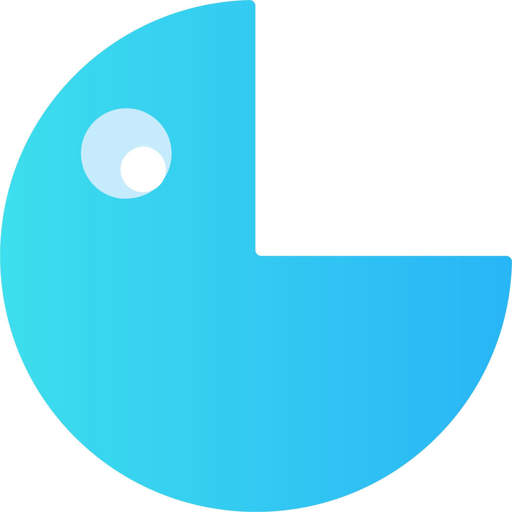

<p align="center">
  
</p>

<p align="center">
  <strong>Lokale Vibe-Coding-Workbench für Python-Tools:</strong><br>
  planen, prüfen, entwickeln, testen, versionieren und verbinden – auf deinem Rechner.
</p>

<p align="center">
  
  
  
  
  
</p>

---

## Was ist ToolForge?

ToolForge verbindet eine Projektverwaltung mit einem kontrollierten KI-Entwicklungsablauf. Du beschreibst ein Ziel, vergleichst optional lokale Modelle in einem Vorabcheck und lässt daraus einen prüfbaren Aufgabenplan erzeugen. Aider bearbeitet die Aufgaben anschließend schrittweise; bestandene Prüfkommandos – nicht bloßer Agententext – liefern den Erfolgsnachweis.

Alles läuft lokal. Die Workbench ist standardmäßig nur unter `http://127.0.0.1:8000` erreichbar. Cloud-Dienste und ein KI-Anbieter sind für die Grundfunktionen nicht erforderlich.

> **OpenCode Free:** Optional können kostenlose Modelle ohne zusätzliches Konto über den lokal installierten OpenCode-Dienst genutzt werden. Dabei verlassen die Modell-Prompts deinen Rechner in Richtung des kostenlosen OpenCode-Inferenzdienstes; Code, Pläne und Prüfungen bleiben lokal. Details unter [OpenCode Free](#opencode-free-kostenlose-modelle-ohne-konto).

> **Für wen?** Technisch erfahrene Einzelanwender, die lokale Modelle (z. B. LM Studio) und Aider nutzen möchten, dabei aber Pläne, Dateiänderungen, Tests und Freigaben im Blick behalten wollen.

## Funktionsumfang

| Bereich | Funktionen |
|---|---|
| **Projekte** | Anlegen, öffnen, durchsuchen, archivieren, löschen mit Bereinigungsvorschau; Kachel- und Listenansicht; Projektgruppen; ZIP-Export/Import mit Manifest; wiederherstellbare Ordnerlöschung; getrennte pip-/Chocolatey-/npm-Freigaben |
| **Pilot** | Inkrementelle Projektanalyse mit Symbolen und Abhängigkeiten, Zielbeschreibung, Modell-Vorabcheck, prüfbarer Aufgabenplan mit Diff-Vorschau, Aufgaben-Graph, Aider-Batchausführung, Rückfragen, Pause/Fortsetzen, Reparaturstrategien, Erweiterungen ohne Neustart, Fortschrittserhalt, Projektprotokolle |
| **Modellvergleich** | Drei bis sechs Kandidaten, identische Arbeitsproben, ein oder zwei Temperaturen, anonymisierte Auswertung, Empfehlung mit ausdrücklicher Übernahme, Kontextprüfung inklusive kleiner LM-Studio-Rundungsabweichungen; empirische Messreihen mit Wiederholungen, Tokens/s, VRAM-Spitzen und Qualitätsstreuung pro Hardware, Quantisierung und Aufgabentyp |
| **Entwicklung** | Dateibaum und CodeMirror-Editor, konfliktgeprüftes Speichern mit Sicherungen, Python-Ausführung mit Live-Ausgabe und Abbruch, pytest/Ruff/mypy, Git-Status/Diff/ausgewählte Commits/Historie |
| **KI-Unterstützung** | Einzeldatei-Vorschläge mit Diff und ausdrücklicher Übernahme; Erweiterungsvorschläge nach Kategorien; dokumentgestützter Hilfechat |
| **Workflows** | Visueller Knotengraph, Validierung, CSV prüfen, Duplikate entfernen, Excel exportieren, Python-Knoten |
| **Abnahme** | Deklarierte CLI-, lokale HTTP- und Headless-Browser-Szenarien als echte Anwendungsabnahme; getrennte Prüfung von Teständerungen mit Baseline und Review-Schritt |
| **Recherche & Diagnose** | Recherche mit Domainfilter, geöffneten Quellen, Textbelegen und Cache; Journal; ausführliche Fehlerprotokolle mit Redaktion von Geheimnissen |
| **Sandbox** | Optionale Docker-Ausführung für Projektbefehle und Python-Workflowknoten; Images, interne Netzwerke, Speicher-/CPU-/Prozesslimits, Loopback-Ports und Paketinstallation im Container |
| **Bedienung** | Einheitliches V7-/V6-Branding, Dark/Light Design, Hinweiston mit Lautstärke, geführte UI- und Entwickler-Tutorials, SSE-Aktualisierung mit Polling-Fallback, globale Rückfragen, Hilfe direkt in der App; große Bereiche und Editor laden erst bei Bedarf |
| **Betrieb** | Verdeckter Start, eigenes Chrome-/Edge-App-Fenster mit automatischem Schließen, Stoppskript, Debugstart, Logrotation, Plan-Sicherungen, Deinstallationsskript, optionales Tray-Symbol und vorbereiteter Windows-Installer |

## Neu in V1.3

- **OpenCode Free ohne Zusatzkonto:** Der lokal installierte OpenCode-Dienst stellt kostenlose Coding-Modelle bereit. ToolForge verbindet sich über die lokale, passwortgeschützte OpenCode-API und nutzt sie für Vorabcheck, Planung, Hilfe und als OpenAI-kompatible Brücke für Aider. Ein API-Schlüssel ist nicht nötig.
- **Modellquellen-Presets statt Modellnamen-Tricks:** Sechs Vorauswahlen – Nur Lokal, Nur Free, Nur API, Free & Lokal, Lokal & API, Free & API – kombinieren mit MAX Quality, Preis/Leistung oder Kostensparend eine klare Quellen-Reihenfolge. Jede Quelle hat ein eigenes Modellfeld. Die aktive Quelle bleibt beim laufenden Auftrag zuerst.
- **Gemeinsames Free-Kontingent respektiert:** Alle OpenCode-Free-Modelle teilen sich ein Tageslimit. Ein Modellwechsel ist kein zusätzliches Kontingent. Bei Erschöpfung weicht ToolForge nur auf Lokal oder eine bezahlte API aus, wenn die Vorauswahl diese Quelle erlaubt; Nur Free hält mit einem erklärten Hinweis an. OpenCode-Status und eine separate Konsole werden nur auf Klick geöffnet.
- **Mehr Zuverlässigkeit bei kleinen Modellen:** Kleine Modelle unter etwa 16 GB erhalten eine kompaktere Projektübersicht, ganze Dateien statt riskanter Diffs, strengere Formatprüfung und Syntaxfehler mit konkreten Zeilenausschnitten. Aufgabenaufteilung und frische Kontextfenster bleiben erhalten.
- **Pilot-Schaltfläche repariert:** „Pilot öffnen“ startet jetzt tatsächlich das mitgelieferte Desktop-Fenster über die lokale Python-Umgebung; Fehlstarts werden mit Protokollpfad gemeldet. „Cockpit öffnen“ bleibt als separater Weg in die Browser-Workbench erhalten.
- **Vorabcheck wiederholbar:** Nach Fehlern oder Planänderungen lässt sich der Vorabcheck mit den gespeicherten Kandidaten und dem Auswertungsmodell direkt erneut starten. Der letzte Bericht bleibt sichtbar, markiert veraltete Aufgabe bzw. Quellen-Vorauswahl und zeigt übersprungene Kandidaten sowie gemessene Ausweichquellen.
- **Durchgängig V1.3:** API und FastAPI-Metadaten melden `1.3.0`, die Workbench Stage `13`; Frontend-Paket, Installer, Startbanner, Setup-Ausgabe, Hilfe und Dokumentation nennen V1.3 beziehungsweise dreizehn Etappen.

## Funktionsbasis V1.2

- **Einheitliches Branding:** Das V7-Logo aus `frontend/logos` steht in Sidebar, Abschlussbildschirm und Willkommensdialog. Unten links bleibt genau ein verlinktes „by DigitEgal“, dessen Schriftzug jetzt die V6-Wortmarke als Bild nutzt; Größe und Kontrast sind auf die Sidebar abgestimmt.
- **Schnellerer Start:** Cockpit, Hilfe, Projektverwaltung, Analyse, Entwicklungsbereich und Codeeditor werden per `React.lazy`/`Suspense` erst beim Öffnen geladen. Der initiale JavaScript-Block sinkt von rund 955 kB auf rund 261 kB; der Editor bleibt ein separater, bedarfsgeladener CodeMirror-Block.
- **Dauerhaft cachebare Assets:** Gehashte Dateien unter `/assets/` erhalten `public, max-age=31536000, immutable`; `index.html` bleibt `no-cache`, damit ein Update sofort erkannt wird.
- **Aufgeräumte Dokumentation:** Alle Testberichte und Umgebungsdaten stehen in einem aktuellen [TESTBERICHT.md](TESTBERICHT.md). Historische Anforderungsabgleiche liegen im Archiv; versionsspezifische Einzelberichte, alte Umgebungsdateien und nicht mehr verwendete SVG-Logo-Duplikate wurden entfernt.

## Funktionsbasis V1.1

- **Vollständige inkrementelle Projektanalyse:** Der Index speichert Dateisignaturen, Symbole, Importe und Abhängigkeiten; nur geänderte Dateien werden neu gelesen. Große Projekte werden in belegten, größenbegrenzten Teilschritten analysiert, inklusive Manifest und Abdeckungsanzeige.
- **Empirische Messreihe statt Familienvorauswahl:** Wiederholte Arbeitsproben über mehrere Kontextgrößen, Tokens/s, VRAM-Spitzen und Qualitätsstreuung; Ergebnisse werden pro Hardware, Quantisierung und Aufgabentyp zwischengespeichert.
- **Plan-Diff mit Risikovorschau:** Abhängigkeiten, Aufwand, neue Prüfungen und bereits geprüfte Teile werden vor der Übernahme verglichen. Änderungen an geprüften Aufgaben benötigen eine ausdrückliche Bestätigung; vorher entsteht eine Plan-Sicherung.
- **Anwendungsabnahme:** Deklarierte CLI-, HTTP- und Browser-Szenarien prüfen das fertige Werkzeug als Anwendung. Teständerungen werden gegen eine Baseline als Diff ausgewiesen und gesondert freigegeben.
- **Reproduzierbare Umgebungen:** `aider-chat==0.86.2` und der getestete Controller-Stand sind gepinnt; Umgebungssperren enthalten Paketversionen, Dateihashes und Docker-Digests. Presets lassen sich ohne API-Schlüssel exportieren und importieren.
- **Aufgaben-Graph:** Knoten, Kanten, kritischer Pfad, bereite Aufgaben und Dateikonflikte; Prioritäten werden vor der Aufgabenauswahl übernommen. Parallele Nutzung derselben Datei braucht eine ausdrückliche Freigabe.
- **SSE und globale Rückfragen:** Session- und globale Ereigniskanäle aktualisieren die UI ohne dauerndes Polling; langsames Polling bleibt als Fallback. Offene Rückfragen erscheinen projektübergreifend.
- **Belegte Recherche:** Domainfilter, Ablehnung lokaler/IP-Literal-Ziele, tatsächlich geöffnete Quellen, Textbelege, siebentägiger Cache und Zuordnung zu Aufgabe oder Fehler.
- **Betrieb und Wiederherstellung:** Projekt-Export/Import als ZIP, Logrotation, Plan-Sicherungen, Installer-Definition, Build-/Signierskript und optionales Tray-Symbol.
- **Sandbox-Komfort:** Ressourcenregler, Image- und Netzwerkverwaltung, Loopback-Ports und pip-/npm-Paketinstallation in abgeleiteten Projektimages.

Die vollständige Zuordnung steht in [ABNAHME.md](ABNAHME.md). Testumfang und Prüfgrenzen dokumentiert [TESTBERICHT.md](TESTBERICHT.md).

## Installation unter Windows

**Voraussetzungen**

- Windows 10/11
- Python 3.11 oder neuer
- Internetverbindung für Setup und Pakete
- Optional: [LM Studio](https://lmstudio.ai/) mit aktivierter Native REST API v1
- Optional: [OpenCode](https://opencode.ai) und Node.js/npm für kostenlose Modelle ohne Zusatzkonto
- Optional: Docker Desktop für die Sandbox

**Schritte**

1. ZIP in einen neuen Programmordner entpacken. Einen eventuell laufenden alten ToolForge-Server vorher beenden.
2. `Setup_ToolForge.cmd` ausführen. Das Setup legt `.venv` für die Workbench und `.aider-venv` für Aider an und prüft Aider tatsächlich auf Version und benötigte Optionen. Ist npm vorhanden, installiert es zusätzlich optional `@opencode/cli` und startet den lokalen OpenCode-Dienst; ohne npm bleibt OpenCode einfach deaktiviert.
3. `Start_ToolForge.cmd` öffnen. Die UI startet unter `http://127.0.0.1:8000`; unter Chrome/Edge öffnet sich ein eigenes App-Fenster.
4. Beim ersten Start führt ein Willkommensdialog in das UI-Tutorial ein.
5. Unter **Einstellungen → Modellquellen** eine Vorauswahl treffen, zum Beispiel **Free & Lokal**, die gewünschte Reihenfolge wählen und pro Quelle ein Modell laden. Für Nur API Basisadresse und Sitzungsschlüssel eintragen.

```text
Setup_ToolForge.cmd        einmalig einrichten
Start_ToolForge.cmd        Workbench starten
Start_ToolForge_Debug.cmd  bei Startproblemen; Log unter runtime/startup.log
Stop_ToolForge.cmd         Notfall-Stopp bei hängender UI
```

Node.js ist für die normale Nutzung nicht erforderlich – das gebaute Frontend liegt bei.

### OpenCode Free: kostenlose Modelle ohne Konto

OpenCode ist ein separat installierter Coding-Agent mit lokalem Hintergrunddienst. ToolForge nutzt dessen lokale API, um kostenlose Modelle wie `deepseek-v4.1-flash-free`, `glm-5.3-flash-free` oder `minimax-m3.1-flash-free` für Vorabcheck, Planung, Hilfe und Aider zu verwenden. Es wird kein OpenCode-Konto und kein API-Schlüssel in ToolForge gespeichert.

1. `Setup_ToolForge.cmd` ausführen, falls npm vorhanden ist. Alternativ manuell `npm install -g @opencode/cli` und `opencode service start`.
2. Unter **Einstellungen → Modellquellen → OpenCode Free** den Status prüfen, den Dienst starten oder die Konsole öffnen. Diese Aktionen laufen nur auf Klick.
3. Ein Free-Modell auswählen und die Quellen-Vorauswahl speichern. Optional lässt sich eine bevorzugte Free-Modellreihenfolge für temporäre Modellfehler hinterlegen; sie ist kein Kontingent-Reset.
4. Alle Free-Modelle teilen sich ein Tageslimit. Bei Erschöpfung versucht ToolForge nur dann Lokal oder eine bezahlte API, wenn die gewählte Vorauswahl diese Quelle erlaubt. Bei Nur Free wird der Lauf mit einem Hinweis angehalten; lokale Modelle bleiben unabhängig nutzbar.

Die kostenlosen Modelle laufen über den OpenCode-Inferenzdienst. Prompts und die zur Aufgabe gehörenden Dateiauszüge werden dafür an diesen Dienst gesendet. Für vollständig lokale Verarbeitung LM Studio verwenden.

**Optionaler Installer und Tray:** Unter [installer/](installer/README.md) liegt eine Inno-Setup-6-Definition mit Build- und Signierskript. Der Installer installiert nach `%LOCALAPPDATA%\Programs\ToolForge`; Python 3.11 oder neuer bleibt Voraussetzung. Ohne Code-Signaturzertifikat (`TOOLFORGE_SIGN_CERT`) wird er unsigniert gebaut. Das Tray-Symbol ist optional und benötigt `pip install -r requirements-tray.txt`; ohne diese Pakete startet ToolForge normal weiter.

### Linux

```bash
python3 -m venv .venv
. .venv/bin/activate
pip install -r requirements.txt
python start_toolforge.py
```

Für Aider gilt derselbe getrennte Ansatz wie unter Windows; Details stehen in der Hilfe.

## Erster Arbeitsablauf

1. **Projekt anlegen** und einen Arbeitsordner außerhalb des ToolForge-Programmordners verbinden.
2. **Ziel beschreiben** und im Vorabcheck drei bis sechs Modelle vorschlagen lassen – lokal aus LM Studio oder kostenlos über OpenCode Free.
3. **Vorabcheck starten** oder direkt **„Automatisch: Vorabcheck → Empfehlung → Plan → Start“** wählen.
4. Empfehlung prüfen, Plan ansehen und die Ausführung starten. Offene Rückfragen erscheinen im Cockpit.
5. Bestehende Tools über **Entwicklungsbereich → Verbesserungen** erweitern, statt neu zu beginnen.
6. Mit **Dateien & Editor**, **Ausführen & Prüfen**, **Git** und **Workflows** weiterarbeiten.

Die Entwicklungs-Tabs folgen dem Ablauf: **Verbesserungen · Dateien & Editor · KI-Änderungen · Ausführen & Prüfen · Git · Workflows**.

## Deinstallation

```text
Deinstallieren_ToolForge.cmd
```

Entfernt `.venv`, `.aider-venv`, `frontend/node_modules`, `frontend/dist`, `runtime`, `.pytest_cache` und Python-Caches. Auf Wunsch wird `%APPDATA%\ToolForgePilot` gelöscht. **Eigene Projektordner werden nie verändert.** Danach den Programmordner manuell löschen.

Ohne Rückfragen:

```powershell
python uninstall_toolforge.py --yes
python uninstall_toolforge.py --yes --keep-data
```

## Sicherheit und Datenschutz

- **Lokal:** Serverbindung an `127.0.0.1`, CORS auf lokale Adressen begrenzt, Zugriffslogs standardmäßig aus. OpenCode Free ist optional und nutzt einen lokalen Dienst, der die Modell-Prompts an den kostenlosen OpenCode-Inferenzdienst weiterleitet.
- **Keine stillen Cloud-Aufrufe:** Websuche ist opt-in und nutzt ausschließlich DuckDuckGo. Jeder Versuch – auch Fehler und null Treffer – landet im Projektjournal.
- **Keine pauschalen Rechte:** pip-, Chocolatey- und npm-Installationen sind getrennt freigebbar; Prüfwerkzeuge haben eine eigene Einmal-Freigabe.
- **Geheimnisse:** API-Schlüssel werden in Logs redigiert; ausführliche Diagnosen sind opt-in.
- **Projektordner bleiben unangetastet:** Löschvorgänge sind auf ToolForge-eigene Daten und bestätigte Projektordner begrenzt.
- **Docker ist optional:** Ohne Docker laufen Befehle auf dem Host. Die Containeroption ist keine vollständige Virtualisierung der Workbench.

## Dokumentation

- [Abnahme und Anforderungsabgleich V1.3](ABNAHME.md)
- [Konsolidierter Testbericht V1.3 mit Archiv](TESTBERICHT.md)
- [Entwicklungspfad](TOOLFORGE_ROADMAP.md)
- [LM Studio und Modell-Vorabcheck](LM_STUDIO_PRESETS.md)
- [Start und Projekte](help/01_Start_und_Projekte.md)
- [Modelle und Aufgaben](help/02_Modelle_und_Aufgaben.md)
- [Entwicklungsbereich](help/03_Entwicklungsbereich.md)
- [Recherche, Diagnose und Sandbox](help/04_Recherche_Diagnose_Sandbox.md)
- [Windows-Installer](installer/README.md)
- [Nächste Optimierungen](NAECHSTE_SCHRITTE.md)

Die Hilfe ist auch direkt in der App unter **Hilfe** erreichbar.

## Entwicklung und Tests

```bash
python -m pip install -r requirements-dev.txt
python -m pytest -q tests backend/tests
npm --prefix frontend run build
```

Der Frontend-Build führt `tsc --noEmit` und den Vite-Produktionsbuild aus. Die Tests verwenden isolierte Projekte und simulierte Modell-/Docker-Antworten. Reale Modellqualität, GPU-/VRAM-Verhalten, Docker Desktop, echte Aider-Läufe, Signierung und Tray müssen auf der Zielmaschine zusätzlich geprüft werden. Details und Grenzen: [TESTBERICHT.md](TESTBERICHT.md).

### Projektstruktur

```text
backend/            FastAPI, Projekt-API, Pilot-Brücke, Workspace, Workflows
toolforge_pilot/    Engine, Aider-Adapter, Vorabcheck, Installationen, Recovery
frontend/src/       React-/TypeScript-Oberfläche inklusive Tutorials
frontend/logos/     V7-Tool-Logo und V6-DigitEgal-Wortmarke
tests/              Engine-, Pilot- und Regressionstests
backend/tests/      API-, Datenbank- und Migrationsprüfungen
help/               Bedienungsdokumente für die App
installer/          Inno-Setup-Definition, Build- und Signierskript
docs/archiv/        Historische Anforderungsabgleiche und Basisspezifikation
```

## Bekannte Grenzen

- LM Studio muss installiert sein und die Native REST API v1 bereitstellen. Die Messreihe empfiehlt nur eine auf dieser Hardware gemessene Stichprobe, keine allgemein beste Modellfamilie.
- OpenCode Free benötigt eine lokale OpenCode-Installation. Die kostenlosen Modelle teilen sich ein Tageslimit; bei vollständiger Erschöpfung ist bis zum Reset kein freies Cloud-Modell verfügbar. Prompts werden dabei an den OpenCode-Inferenzdienst gesendet.
- Der Modell-Vorabcheck und die Messreihe ersetzen keine fachliche Prüfung. Quantisierung, Treiber und andere laufende GPU-Anwendungen beeinflussen Tokens/s, VRAM-Spitzen und Qualitätsstreuung.
- Docker, Aider, GPU-Messungen, Tray und Installer-Signierung werden nicht durch simulierte Tests ersetzt. In der dokumentierten Testumgebung lief kein Docker-Daemon; Inno Setup und `signtool` waren nicht installiert.
- Ein vollständig eingefrorener Betriebssystemprozess muss im Taskmanager beendet werden. ToolForge beendet niemals pauschal fremde Python-Prozesse.
- Ein Browser außerhalb des ToolForge-App-Fensters darf per Skript nicht geschlossen werden; dort erscheint ein Abschlussbildschirm.

## Versionsgeschichte

| Version | Schwerpunkt |
|---|---|
| 0.1 | Projektverwaltung, lokale Persistenz, Workbench-Grundgerüst |
| 0.2 | Projektanalyse/Dashboard, getrennte Paketfreigaben, Installationsjournal |
| 0.3 | Aider-Batchmodus, Plan-JSON, Modellwarnungen, Kontext/Temperatur, Diagnose, Logs |
| 0.4 | Schleifen-/Tokenlimits, frischer Kontext, begrenzte Neuplanung, Gesamtprüfung |
| 0.5 | Plan speichern/importieren, Projektlebenszyklus, unabhängige Aufgaben trotz Rückfragen |
| 0.6 | Editor, Python-Ausführung, Qualitätsprüfungen, Git, KI-Diffs, Workflows, CSV/Excel-Abnahme |
| 0.7 | Modell-Vorabcheck, Arbeitsproben, 15 Presets, 20.000 Startkontext |
| 0.8 | Sechs Probleme und sieben Verbesserungen: Setup, Rückfragen, Fortschritt, Reparatur, Hilfe, Ton, Websuche, Diagnose |
| 0.9 | Projektgruppen, Listenansicht, Tutorials, Branding – in V1.0 nachgezogen |
| **V1.0** | **Pillow-Selbstreparatur, Browser-Schließen, Ein-Klick-Ablauf, Kontexttoleranz, 3–6 Kandidaten, Deinstallation** |
| **V1.1** | **Inkrementeller Projektindex, empirische Messreihe, Plan-Diff, Anwendungsabnahme, gepinnte Umgebungen, Aufgaben-Graph, SSE, belegte Recherche, Export/Import, Installer/Tray, Sandbox-Komfort** |
| **V1.2** | **V7-/V6-Branding, konsolidierter Testbericht, aufgeräumte Altlasten, Code-Splitting mit deutlich kleinerem Start-Bundle, immutable Asset-Cache und zwölfte Etappe** |
| **V1.3** | **OpenCode Free ohne Zusatzkonto, bewusste Modellquellen-Presets statt Free-Modellwechsel bei Tageslimits, konfigurierbare Reihenfolge, zuverlässigere kleine Modelle, reparierter Desktop-Pilot und wiederholbarer Vorabcheck** |

## Lizenz und Credits

MIT-Lizenz – siehe [LICENSE](LICENSE). Copyright © 2026 **DigitEgal**.

ToolForge nutzt unter anderem FastAPI, Uvicorn, SQLite, React, TypeScript, Vite, CodeMirror und Aider. LM Studio, OpenCode und Docker sind optionale, separat zu installierende Werkzeuge.
